<p align="center">
  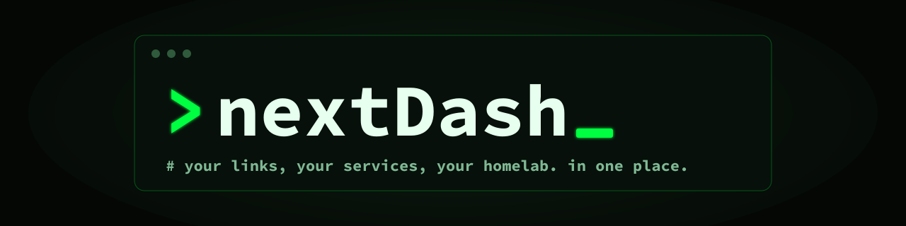
</p>

# nextDash

> 🇨🇳 **本应用支持简体中文。** nextDash 的界面提供中文语言选项 — 在设置中将语言切换为「中文」即可。

**A keyboard-first, self-hosted dashboard for your links, your services and your homelab. No accounts, no cloud, no noise.**

It started because my bookmark bar had become a graveyard, and grew into one place that shows how your whole setup is doing. Run it on any machine or container, open it in your browser, and reach everything from the keyboard.

- **Bookmarks** across pages and categories, with tags, notes, an inbox for links you have not filed yet, smart collections, and search, commands and finders in one panel.
- **Health and monitoring.** Dead links, uptime with 30 days of history, certificate and domain expiry, page drift and a public status page, with alerts to ntfy, Slack, Discord, Telegram and more, or a push notification on your phone.
- **Containers and homelab.** A Containers view for the Docker host: logs, start, stop, update with a rollback, and each container linked to its bookmark. Widgets for Unraid, Jellyfin, Jellystat, Sonarr, Bazarr, Prowlarr, Home Assistant, Beszel and Glances.
- **Widgets** for what is going on: weather, calendar, feeds, inbox, your machine, and any service that answers with JSON.
- **Looks.** 390 themes, 267 backdrops and a theme studio, in six languages.
- **An assistant, if you want one.** Ask in plain words with Claude, OpenAI or a model of your own, and decide what happens to what it suggests. Off until you turn it on.
- **Yours to keep.** One Go binary and plain JSON files, automatic backups, a 30-day trash, and imports from every browser, Pocket, Raindrop, linkding and more.

<p align="center">
  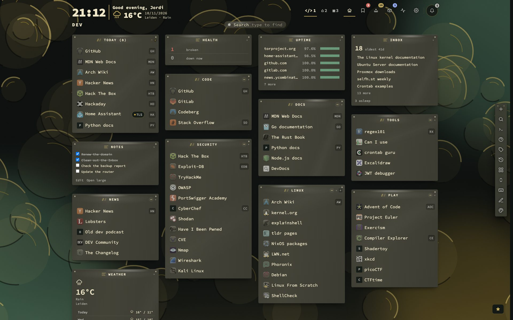
</p>

🎨 **390 themes and a theme studio.** 195 theme families, each with a light and a dark half, drawn from twelve materials — lacquer, glass, frost, aurora, neon, velvet, enamel, brushed metal, carbon, paper, terminal and ink — and from three collections: eight neutrals, the Looks and ThinkDashboard Classic, plus three holiday themes with snow and lights. **Tarnished Brass** is the default on a new install (an install that already chose a theme keeps it), and every material draws its own surface, category header and widget header, as a **signature** or in the flat **Classic** way. **`Shift + A`** opens the theme studio beside your dashboard and changes the real page as you go: the theme, 267 backdrops with a quiet centre behind the bookmarks, depth, glow and card glass, the category headers, the type and the contrast — or one of twelve ready-made looks that set them all at once. **Compare** shows what you had, 🎲 tries something at random, and nothing is saved until **Apply**. Search by name or material, keep up to 24 favourites, follow your system's light and dark mode, or recolour any theme and build your own in the theme editor. *[Manual: The new look](MANUAL.md#17a-the-new-look)* · *[Manual: Appearance](MANUAL.md#17-appearance)*

<details>
<summary><b>See every theme</b> — all 192 dark and all 192 light, each on the same dashboard</summary>

<p align="center">
  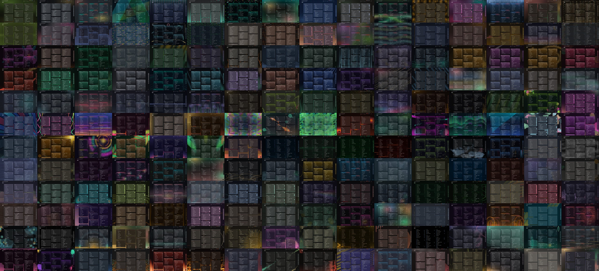
  <br />
  <sub><b>All 192 dark themes</b> — the same dashboard in every theme, each with its own material and backdrop.</sub>
</p>

<p align="center">
  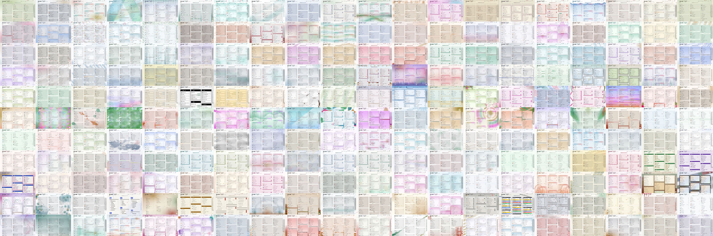
  <br />
  <sub><b>All 192 light themes</b> — the light half of every family.</sub>
</p>

</details>

Based on [ThinkDashboard](https://github.com/MatiasDesuu/ThinkDashboard) by MatiasDesuu.

📖 **[User manual (MANUAL.md)](MANUAL.md)** — how everything works, from the first launch to self-hosting. · [Glossary](MANUAL.md#glossary)

📋 **[Changelog (CHANGELOG.md)](CHANGELOG.md)** — every release, new and fix.

🗂️ **[Cheat sheet](nextDash-cheatsheet.pdf?raw=true)** — every keyboard shortcut, printable ([HTML](nextDash-cheatsheet.html?raw=true)). Press **?** or **F1** on the dashboard for the live list. Regenerate with `npm run generate:cheatsheet`.

🌐 **Website:** [nextdash.cc](https://nextdash.cc)

🌐 **Dev log:** [www.jordibrw.nl](https://www.jordibrw.nl)

🌐 **Demo:** [demo.nextdash.cc](https://demo.nextdash.cc)


🧩 **Save a link from anywhere:** a browser extension, a share sheet, a bookmarklet, a shell one-liner, Raycast, Dropzone 5, Alfred, Apple Shortcuts and Ulauncher — see [What nextDash talks to](#what-nextdash-talks-to).

---

## 🏠 Run your self-hosted setup from one screen

nextDash is a bookmark dashboard that also knows your Docker host. The link to Sonarr, the Sonarr container and the check that watches it are one thing, not three tabs in three different tools.

**How it fits together**

1. **Containers** — the Containers view (`Shift + C`, `#docker`) lists every container on the host: a status glow, CPU, RAM, size on disk, ports, its web UI, healthcheck results and a timeline of what happened to it. Start, stop, restart, update, roll back or follow its logs from the keyboard, one container, a compose stack or a whole selection at a time.
2. **Bookmarks** — each container's web UI is matched to the bookmark you already have for it: by port, by subdomain behind a reverse proxy, or by name — or by hand. The container row carries that bookmark's health mark; the bookmark's side panel says which container it **runs in**. Open the service from the dashboard, from search, or with `:docker sonarr open`.
3. **Health** — set that bookmark to **Monitor** and the server checks it on its own, as often as every five minutes: 30 days of uptime and response times, outages, certificate expiry, a phrase the page must contain, the status codes that count as healthy, and drift when a page turns into something else. A service behind a sign-in can be checked on a status address, with a stored key.
4. **Alerts and push** — a site that goes down and a container that crashes, keeps restarting, turns unhealthy or runs hot reach you the same way: ntfy, Pushover, Gotify, Telegram, Slack, Discord, Apprise, your own JSON receiver, or a push notification on your phone, even with the dashboard closed. Recovery is announced too, and a host that takes ten services down sends one message, not ten.

**Keeping it current and tidy.** Image update checks run on an interval and show the release notes behind an update. Skip a version, hold a container, or let nextDash update it in a nightly window: each update is watched for five minutes and rolled back when the container stops, loops or turns unhealthy. The **Disk** tab shows what images, volumes, build cache and bind mounts take up, and clears it after naming what goes.

**On the dashboard.** A homelab page can carry the **Containers** and **Container list** widgets, **Uptime**, **Certificates**, **Health**, **Processor**, **Memory** and **Disks**, seven **Unraid** widgets (overview, array, parity, shares, VMs, UPS and notifications) that read the server through its API, media widgets for **Jellyfin**, **Emby**, **Plex**, **Sonarr**, **Radarr**, **Seerr**, **Jellystat**, **Bazarr**, **Prowlarr**, **qBittorrent** and **SABnzbd** — what was added, who is watching and who watched what, what is coming, what was requested, which subtitles are missing, how the indexers are doing and what is downloading, with the posters from your own library — a **Home Assistant** widget that switches lights, switches and scenes from the page, four **Beszel** widgets that show how your other machines are doing, and a **Custom widget** that reads Sonarr, Plex, Pi-hole, Proxmox, Home Assistant and 36 more services — next to the bookmarks for all of them.

<table border="0" width="100%">
  <tr>
    <td width="50%" align="center" valign="top">
      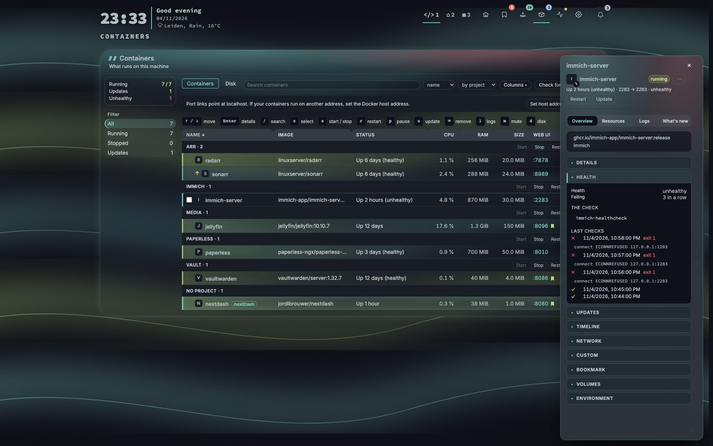
      <br />
      <sub><b>Containers and health</b> <i>(Deep Lagoon)</i> — Grouped by compose project, each container with a status glow and its health in the status column; Immich is the red row. The side panel says why: the failing healthcheck and the output of its last checks, three in a row.</sub>
    </td>
    <td width="50%" align="center" valign="top">
      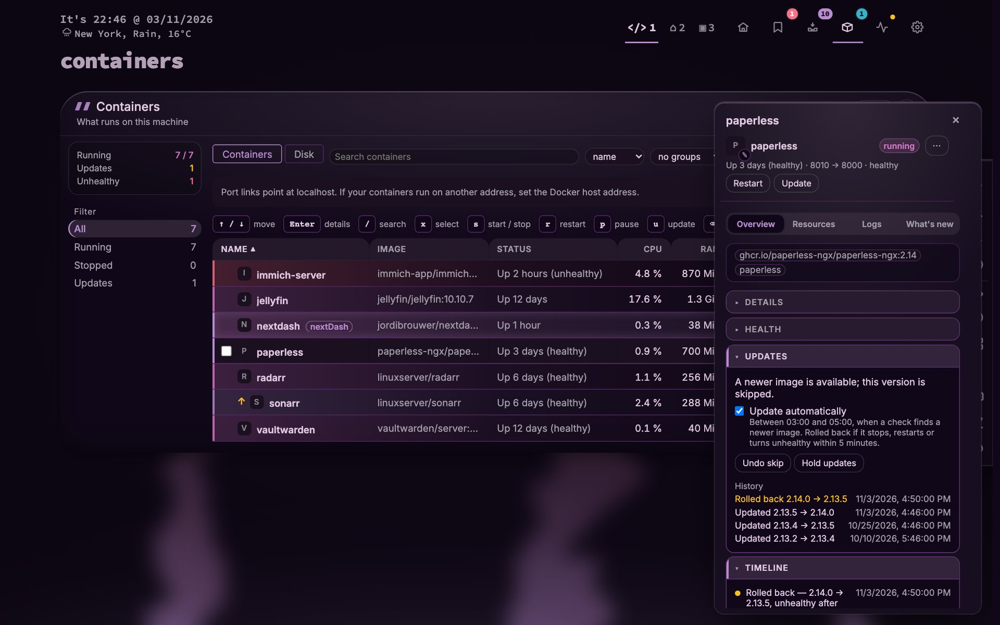
      <br />
      <sub><b>Updates with a way back</b> <i>(Smoked Plum)</i> — Paperless updates itself between 03:00 and 05:00. Last night's version turned unhealthy within two minutes, so it was rolled back and that version skipped; History and Timeline say what happened.</sub>
    </td>
  </tr>
</table>

📖 **[Self-hosted guide in the manual](MANUAL.md#self-hosted-guide)** — the set-up in four steps, how the pieces link up, and a morning routine. Setting up the Docker socket is under [Containers view](#containers-view) below.

---

## Screenshots
<table border="0" width="100%">
  <tr>
    <td width="50%" align="center" valign="top">
      
      <br />
      <sub><b>Dashboard</b> <i>(Tarnished Brass)</i> — Categories in columns with a live response time on every checked link, and widgets between them: health, uptime with a heartbeat per site, the weather with its forecast, the inbox and a note. The header is one row: a large clock with a greeting and the weather in big type beside the rule, page numbers, the views with their badges, and the notifications bell.
    </td>
    <td width="50%" align="center" valign="top">
      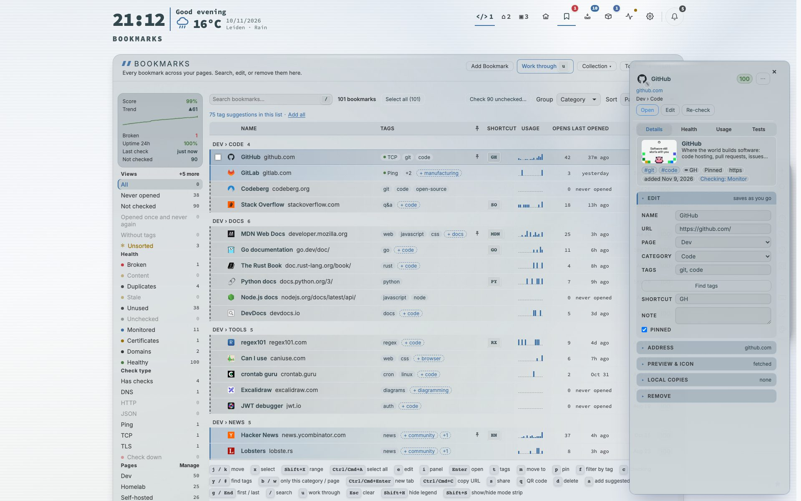
      <br />
      <sub><b>Bookmarks view</b> <i>(Oceanic Steel, light)</i> — The whole collection in one place: a rail with the health score, views, health filters, pages and categories; one row per bookmark with its tags, shortcut, a month of use and when it was last opened; a side panel with Details, Health and Usage that saves as you type.</sub>
    </td>
  </tr>
  <tr>
    <td width="50%" align="center" valign="top">
      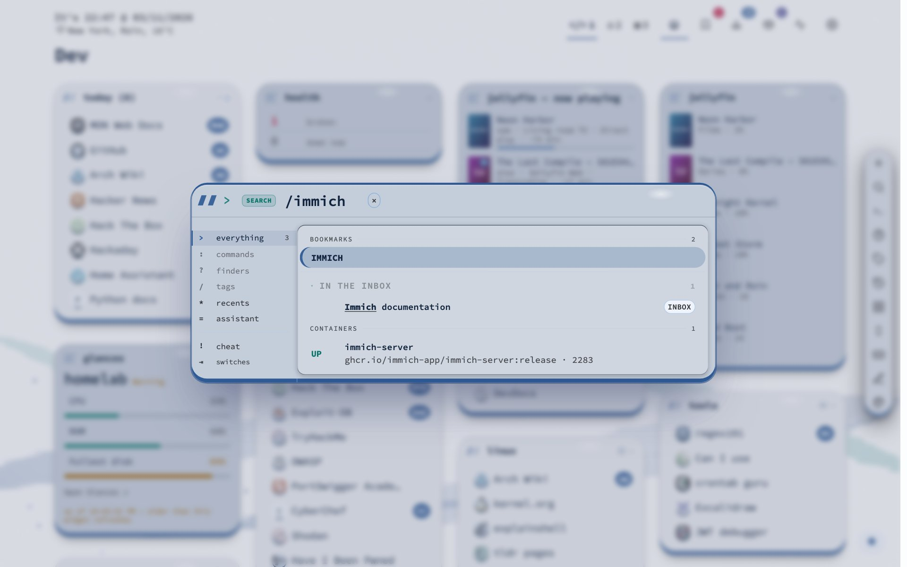
      <br />
      <sub><b>Search</b> <i>(Porcelain Blue, light)</i> — One panel for bookmarks, commands, finders, tags and containers. <kbd>/</kbd> turns a word into a name search: the bookmark by that name and the container that carries it. <kbd>Tab</kbd> switches between the modes on the left.</sub>
    </td>
    <td width="50%" align="center" valign="top">
      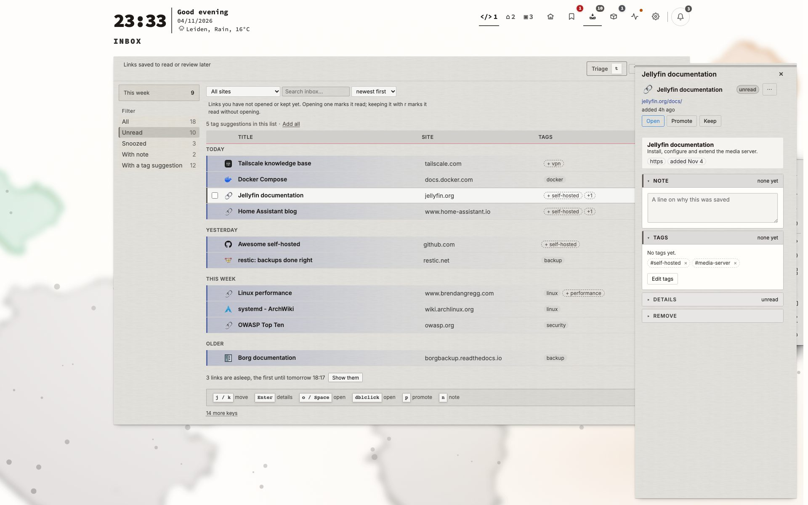
      <br />
      <sub><b>Inbox</b> <i>(Paper Ink, light)</i> — Links saved before you knew where they belong, grouped by when they arrived, with the keys for every action under the list. The side panel holds the note and the tags; open, promote or keep a link without leaving the list.</sub>
    </td>
  </tr>
  <tr>
    <td width="50%" align="center" valign="top">
      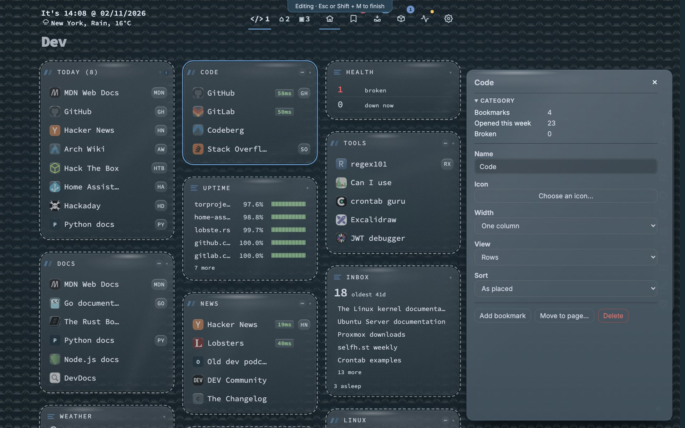
      <br />
      <sub><b>Edit mode</b> <i>(Oceanic Steel)</i> — <kbd>Shift</kbd> + <kbd>E</kbd> or the pencil in the action bar: every block gets an outline, a click chooses one, and a panel beside the page changes its name, icon, width, view and sorting, or a widget's settings, and saves as you type. <kbd>Esc</kbd> leaves.</sub>
    </td>
    <td width="50%" align="center" valign="top">
      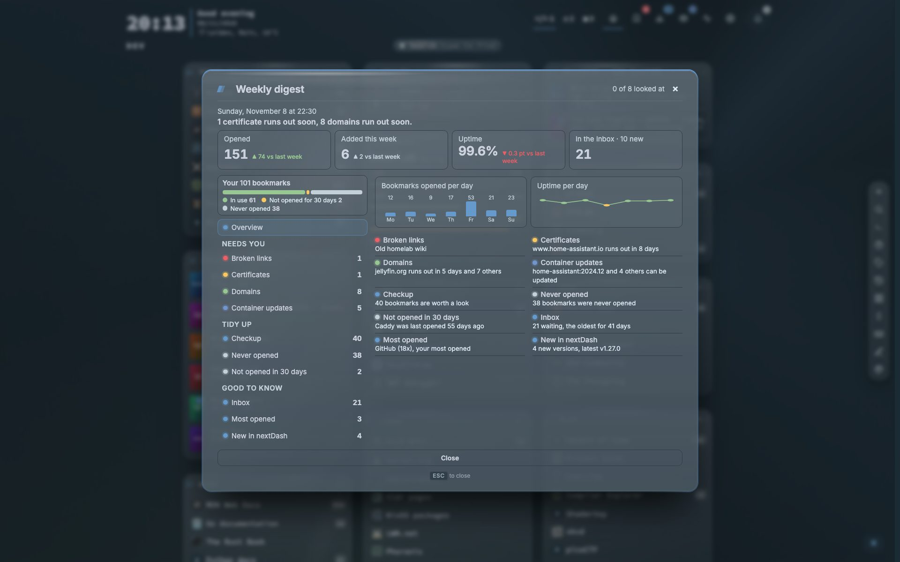
      <br />
      <sub><b>Weekly digest</b> <i>(Oceanic Steel)</i> — The week in figures — opens, new bookmarks, uptime, the Inbox — each next to the week before, then what needs you, what is worth tidying up and what is good to know: broken links with since when and why, certificates and domains running out, container updates, the checkup, what nobody opens and what is new. An overview first, a part per click.</sub>
    </td>
  </tr>
</table>

<details>
<summary><b>More screenshots</b> — fourteen more views, in other themes</summary>
<br />

<table border="0" width="100%">
  <tr>
    <td width="50%" align="center" valign="top">
      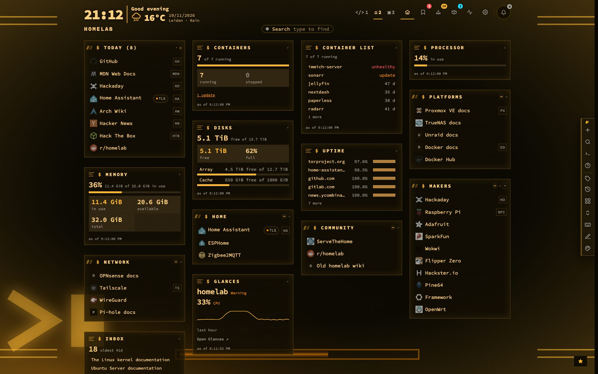
      <br />
      <sub><b>A second page</b> <i>(Terminal Amber)</i> — A homelab page: the container count, the Container list with the failing one first, the processor, memory and disks of the host and the inbox, beside the homelab bookmarks with their own icons and response times.</sub>
    </td>
    <td width="50%" align="center" valign="top">
      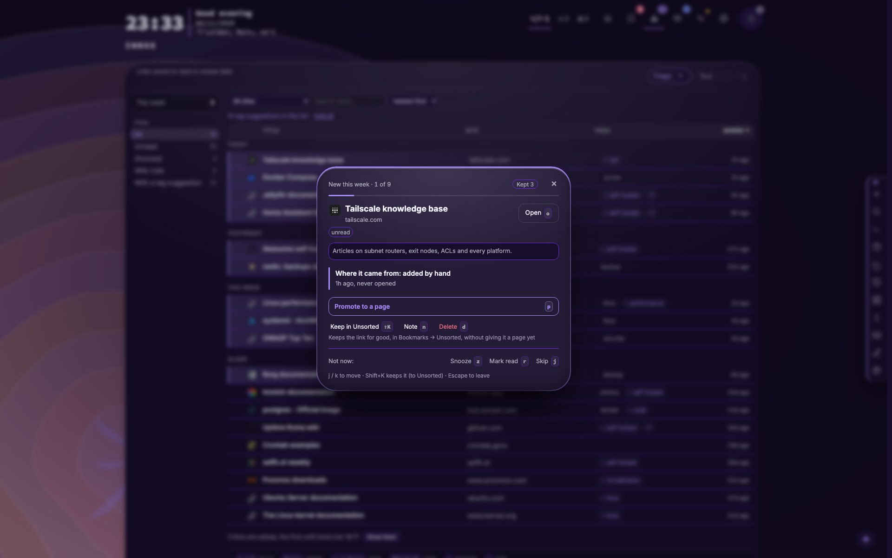
      <br />
      <sub><b>Triage</b> <i>(Royal Amethyst)</i> — <kbd>t</kbd> in the inbox takes the links pile by pile — waiting longest, new this week, with a note — one at a time, each saying where it came from and how long it has waited, with Promote as the clear next step.</sub>
    </td>
  </tr>
  <tr>
    <td width="50%" align="center" valign="top">
      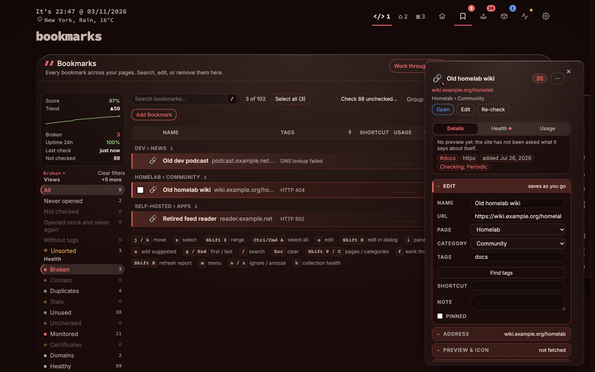
      <br />
      <sub><b>Broken links</b> <i>(Oxblood Leather)</i> — The Bookmarks view on its Broken filter: what does not answer and why, a score for each, and Work through to clear them one at a time. The rail counts every other health filter beside it.</sub>
    </td>
    <td width="50%" align="center" valign="top">
      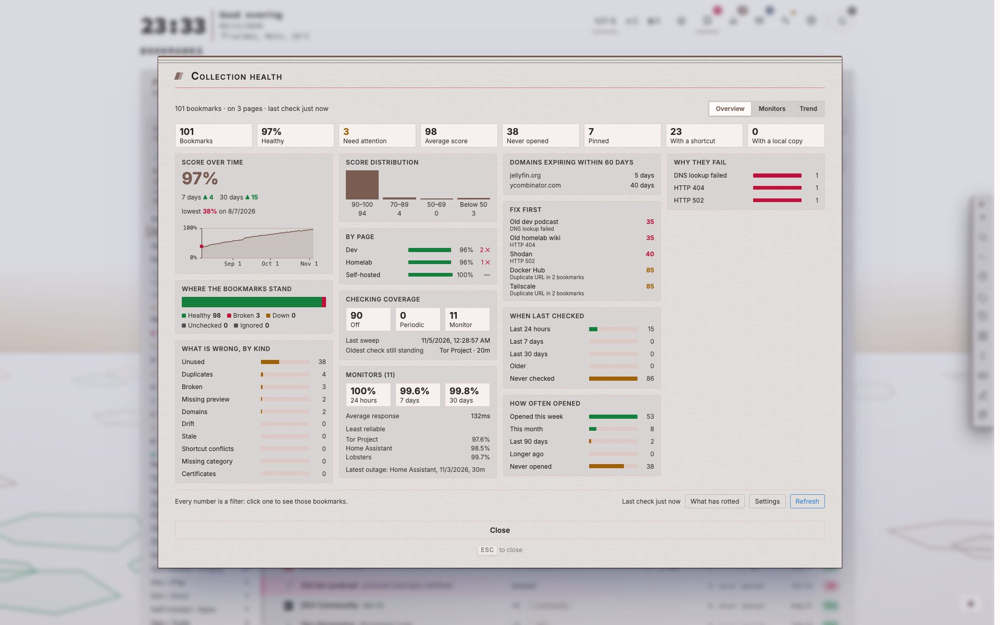
      <br />
      <sub><b>Collection health</b> <i>(Salt Flat, light)</i> — <kbd>h</kbd> in the Bookmarks view: the score over time, what is wrong and of what kind, health per page, checking coverage, monitor uptime with the least reliable named, and certificates running out. Every number opens its filter.</sub>
    </td>
  </tr>
  <tr>
    <td width="50%" align="center" valign="top">
      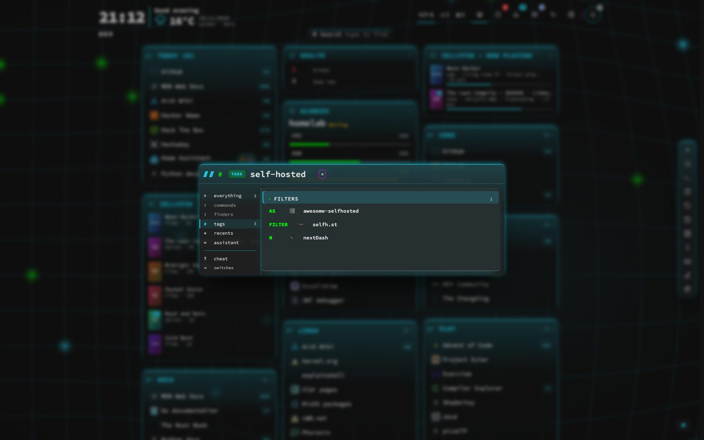
      <br />
      <sub><b>Search by tag</b> <i>(Neon Grid)</i> — <code>tag:self-hosted</code> narrows search to one tag across every page, each result with its icon and shortcut.</sub>
    </td>
    <td width="50%" align="center" valign="top">
      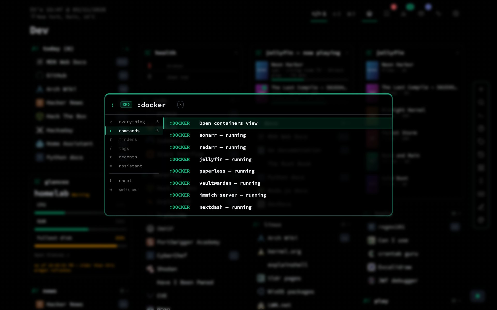
      <br />
      <sub><b>Command palette</b> <i>(ThinkDashboard Classic)</i> — <code>:docker</code> lists every container with its state; pick one to start, stop, restart or update it, open its web UI or read its logs.</sub>
    </td>
  </tr>
  <tr>
    <td width="50%" align="center" valign="top">
      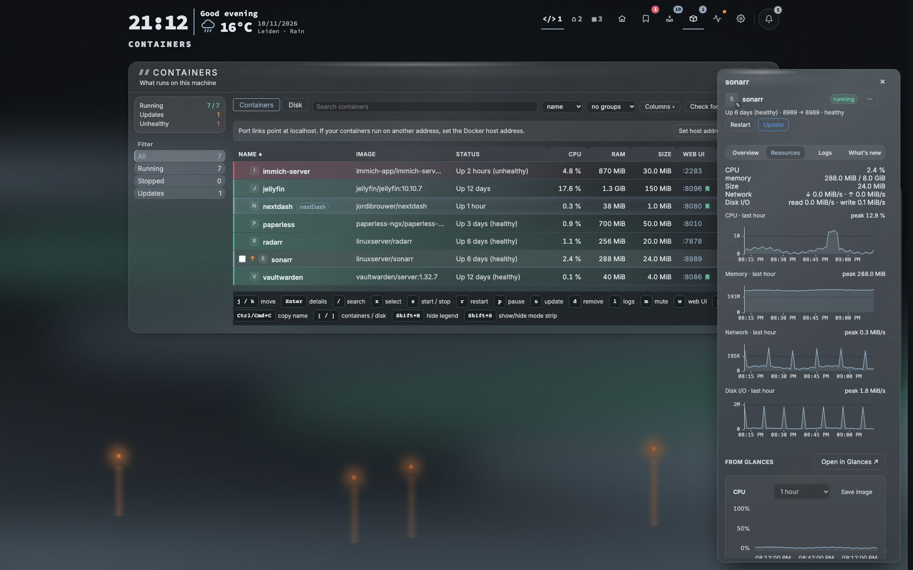
      <br />
      <sub><b>Containers</b> <i>(Harbour Fog)</i> — Every container on the host with its app icon, a status glow, CPU and memory. The side panel draws CPU, memory, network and disk over the last hour. Start, stop and update are one key away once control is on, as the legend under the list shows.</sub>
    </td>
    <td width="50%" align="center" valign="top">
      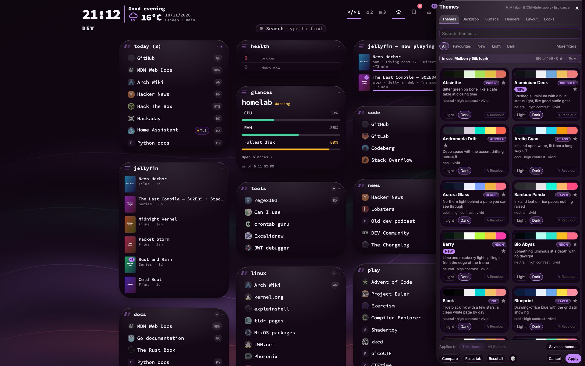
      <br />
      <sub><b>The theme studio</b> <i>(Mulberry Silk)</i> — <kbd>Shift</kbd>+<kbd>A</kbd> opens it beside the dashboard: 195 theme families with a light and a dark half, filtered by material or collection, and tabs for the backdrop, card surface, headers, layout and ready-made looks. Every change shows on your own page, and nothing is saved until Apply.</sub>
    </td>
  </tr>
  <tr>
    <td width="50%" align="center" valign="top">
      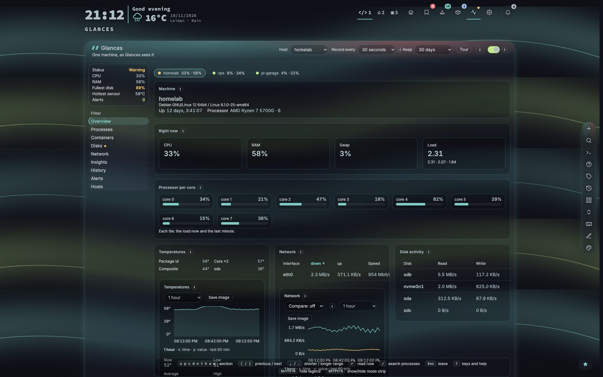
      <br />
      <sub><b>Glances</b> <i>(Deep Lagoon)</i> — One machine, as Glances sees it: its status and fullest figures in the rail, every connected host a click away, and the Overview with the load right now, every core and the temperatures. Processes, Containers, Disks, Network, Insights, History, Alerts and Hosts sit under the same rail.</sub>
    </td>
    <td width="50%" align="center" valign="top">
      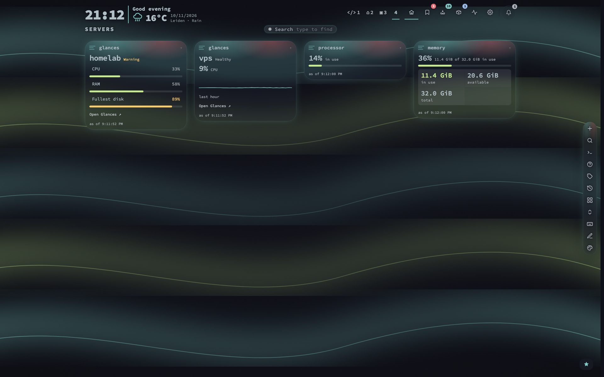
      <br />
      <sub><b>Glances on the dashboard</b> <i>(Deep Lagoon)</i> — Two Glances widgets beside Processor and Memory: one as meters for CPU, RAM and the fullest disk with a status word, one as a graph of the last hour. Each links to the Glances page.</sub>
    </td>
  </tr>
  <tr>
    <td width="50%" align="center" valign="top">
      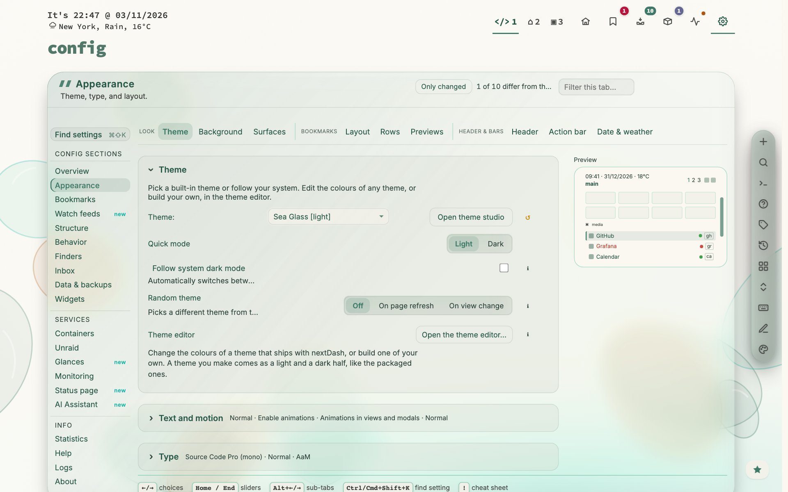
      <br />
      <sub><b>Config → Appearance</b> <i>(Sea Glass, light)</i> — Nine tabs in three groups — Look, Bookmarks, Header &amp; bars — whose panels fold to a line of their values, with a small live preview of your dashboard beside them. Every change applies and saves at once.</sub>
    </td>
    <td width="50%" align="center" valign="top">
      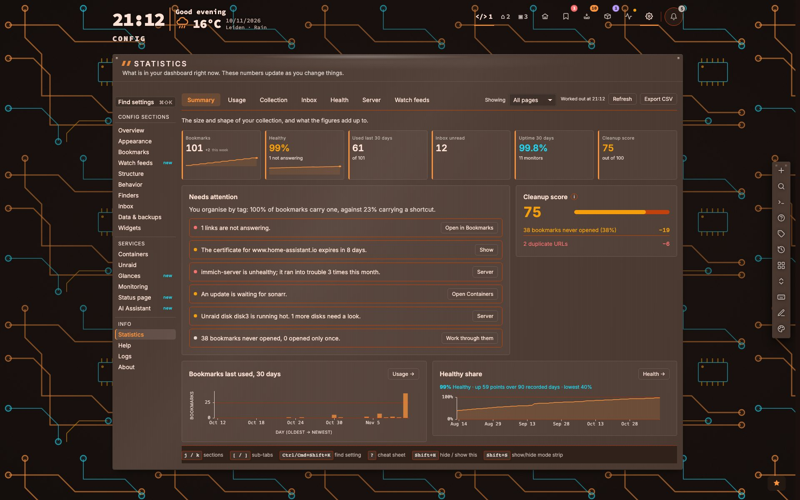
      <br />
      <sub><b>Config → Statistics</b> <i>(Copper Circuit)</i> — Six figures per tab, what needs attention with a button for each, the cleanup score, and charts you can point at — across Summary, Usage, Collection, Inbox, Health and Server.</sub>
    </td>
  </tr>
</table>

<table border="0" width="100%">
  <tr>
    <td width="50%" align="center" valign="top">
      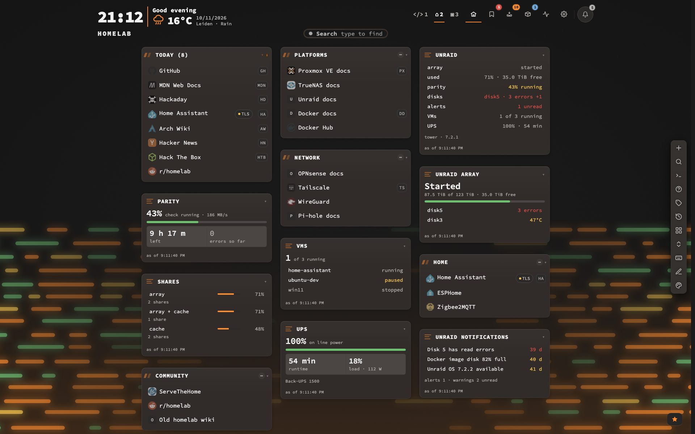
      <br />
      <sub><b>Unraid Black</b> <i>(dark)</i> — A theme for Unraid users: flat black panels and the orange of the Unraid logo, with the Unraid widgets beside the homelab bookmarks.</sub>
    </td>
    <td width="50%" align="center" valign="top">
      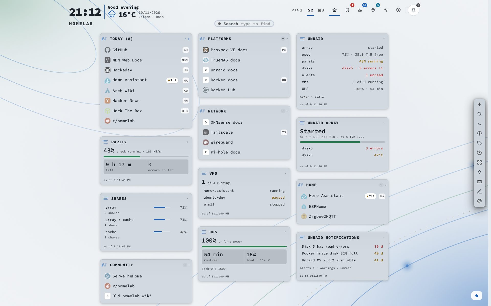
      <br />
      <sub><b>Unraid Azure</b> <i>(light)</i> — The cooler pair: grey-blue panels and a steel-blue accent. Both themes come in a dark and a light variant, as do **Unraid Ember** and **Unraid Blaze**, the logo's orange and red.</sub>
    </td>
  </tr>
</table>

</details>

---

## Quick Start

### Docker Compose (recommended)

```yaml
services:
  nextDash:
    image: ghcr.io/jordibrouwer/nextdash:latest
    container_name: nextDash
    ports:
      - "8080:8080"
    volumes:
      - ./data:/app/data
    environment:
      - PORT=8080
      # On a LAN or VPS, require a token for every write (see Security):
      # - NEXTDASH_WRITE_TOKEN=change-me-to-a-long-random-string
    restart: unless-stopped
```

```sh
docker compose up -d
```

Open `http://localhost:8080`.

**From a git checkout:** `docker-compose.prod.yml` is for production (only `./data` is mounted; CSS and JavaScript are built into the image). `docker-compose.yml` is for development (it mounts `./static`, `./locales` and `./templates`, with Docker actions and root off and the socket commented out). Put your own mounts and variables in `docker-compose.override.yml`; Compose reads it automatically.

```sh
docker compose -f docker-compose.prod.yml up -d --build
```

### Build from source

```sh
go build -o nextDash && ./nextDash
```

Data is stored in `./data`. `NEXTDASH_DATA_DIR` moves it.

### System widgets

The **Processor**, **Memory**, **Disks**, **Containers** and **Container list** widgets report on the machine nextDash runs on. The binary needs no setup; a container needs read-only mounts:

```yaml
    volumes:
      - ./data:/app/data
      - /mnt:/host/root/mnt:ro,rslave                     # Disks: required
      # - /proc:/host/proc:ro                             # Processor, Memory: optional
      # - /var/run/docker.sock:/var/run/docker.sock:ro    # Containers: a real grant
    environment:
      - NEXTDASH_HOST_ROOT=/host/root
      # - NEXTDASH_HOST_PROC=/host/proc
      # - NEXTDASH_DOCKER_SOCKET=/var/run/docker.sock
      # - NEXTDASH_DOCKER_CONTROL=1                       # Containers: start/stop/update/remove
```

### Containers view

> [!IMPORTANT]
> **The Containers view needs three settings before it does anything — and one more on some hosts.**
>
> 1. **The Docker socket.** Mount `/var/run/docker.sock` and set `NEXTDASH_DOCKER_SOCKET=/var/run/docker.sock`. Without both, the view shows a setup card and the Containers widget stays hidden. Read-only (`:ro`) is enough to look.
> 2. **Actions: `NEXTDASH_DOCKER_CONTROL=1`.** Start, stop, pause, restart, update and remove need it. Without it the view only reads.
> 3. **A write token, and a gate in front: `NEXTDASH_WRITE_TOKEN`.** Access to the socket is root on the host — `:ro` on the mount does not stop the Docker API from accepting writes. The token stops other websites and scripts that do not know it. It is not a login: the dashboard hands it to every browser that opens the page. Set one, and keep nextDash behind Tailscale or a reverse proxy with authentication — with actions on, anyone who can open the dashboard can stop, update or remove your containers.
> 4. **Sometimes: `NEXTDASH_RUN_AS_ROOT=1`.** The container starts as root, then drops to its own `nextdash` user, which joins the group the socket belongs to (`docker`, gid 281 on Unraid). When the socket belongs to root's group (gid 0) — Docker Desktop, some NAS systems — that user cannot read it: the log says `is owned by gid 0` and Config → Containers shows **No access to the socket**. `NEXTDASH_RUN_AS_ROOT=1` keeps the app running as root so it can. Only set it then.

**Docker Compose** — add to the nextDash service:

```yaml
    volumes:
      - /var/run/docker.sock:/var/run/docker.sock:ro
    environment:
      - NEXTDASH_DOCKER_SOCKET=/var/run/docker.sock
      - NEXTDASH_DOCKER_CONTROL=1                        # start/stop/restart/update/remove
      - NEXTDASH_WRITE_TOKEN=change-me-to-a-long-random-string
      # - NEXTDASH_RUN_AS_ROOT=1                         # only if the log says "owned by gid 0"
```

**Unraid** — Docker → nextDash → Edit:

- Fill in the template's **Docker socket** path (`/var/run/docker.sock`), **Docker socket variable** (`/var/run/docker.sock`) and **Write token**.
- For actions: set the template's **Docker actions** to `1` (it starts at `0`).
- Unraid's socket belongs to the `docker` group, so leave **Run as root** at `0`.

Once it runs, the `#docker` view lists every container with a status glow, CPU and RAM and a link to its web UI, a side panel with health, a timeline, logs, an hour of CPU and memory charts and release notes, a logs window, a Disk tab, and a badge for images with an update waiting. **Config → Containers** shows the connection as the server sees it — socket, actions, write token, its own container — and holds the update checks and an optional GitHub token. The [manual](MANUAL.md#156-what-it-needs) has the details, including Synology and QNAP.


### Unraid

nextDash reads an Unraid server through its own API (Unraid 7.2, or an older Unraid with the Unraid Connect plugin):

- **Seven widgets** — an overview, the array (every disk with its fill and temperature or its problem), parity, shares by where they live, VMs, the UPS and Unraid's notifications.
- **Alerts** — Unraid's own ALERT notifications, the array stopping, a parity check that finished with errors and a disk whose error count went up, through the same channels as downtime and container alerts.
- **One connection** — set once under **Config → Unraid** with an API key that has the role **Viewer**. nextDash only reads: it never starts, stops or changes anything on the server.

More is on the way: deeper Unraid integration is being worked on for future versions of nextDash. *[Manual: Unraid](MANUAL.md#unraid)*

<table border="0" width="100%">
  <tr>
    <td width="50%" align="center" valign="top">
      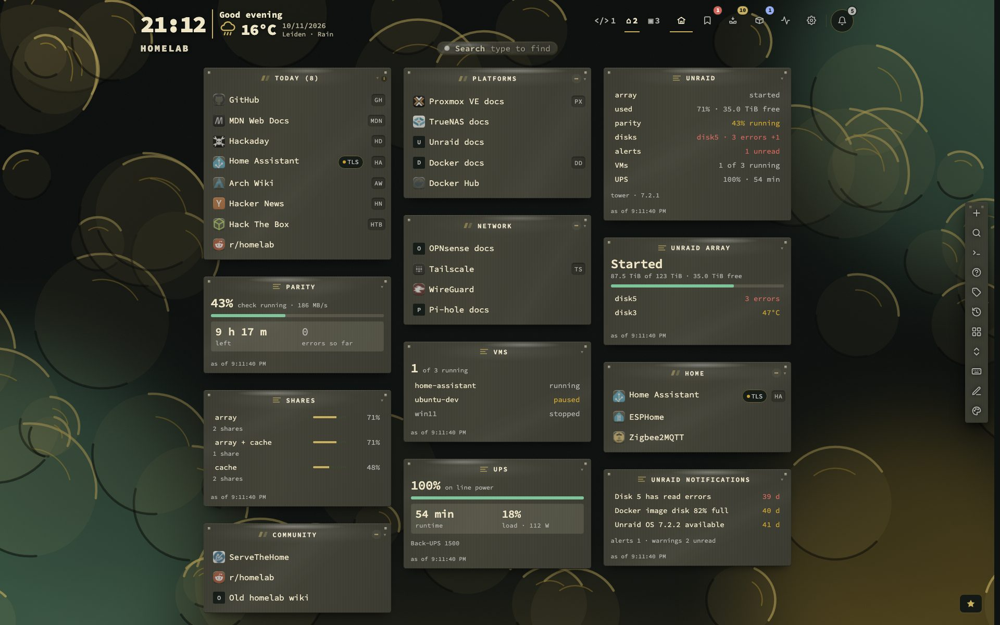
      <br />
      <sub><b>Unraid on the dashboard</b> <i>(Tarnished Brass)</i> — All seven widgets beside the homelab bookmarks. Disk 5 has read errors, so the overview, the array and the notifications all name it in red; parity is 43% through a check, and the UPS is on line power with 54 minutes in reserve.</sub>
    </td>
    <td width="50%" align="center" valign="top">
      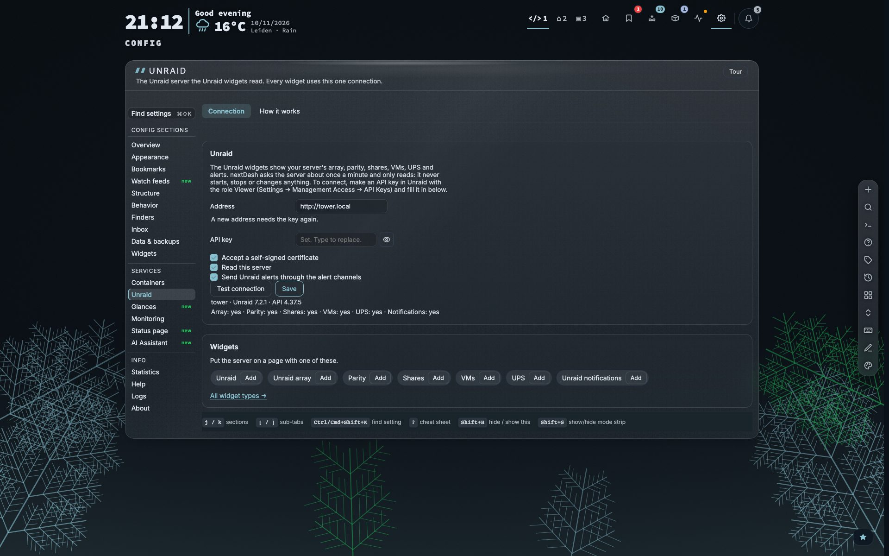
      <br />
      <sub><b>One connection</b> <i>(Nordic Frost)</i> — Config → Unraid: the server's address and a read-only API key, a connection test that reports which of the six areas answers, and the seven widgets under it, each with an Add that opens it in the Add widget picker.</sub>
    </td>
  </tr>
</table>

---

## Security

nextDash is built for **personal or small-team use on a trusted network**. There are no user accounts: anyone who can reach the address can read and change the data unless you put something in front of it.

**Do not expose nextDash directly to the internet.** Use one of these:

- **A private network** — [Tailscale](https://tailscale.com/) or another mesh VPN.
- **A reverse proxy with authentication** — Traefik, Caddy or nginx with basic auth, OAuth2 Proxy or SSO.
- **Local only** — bind to `127.0.0.1` and use an SSH tunnel.

The short version is below; [MANUAL § 24](MANUAL.md#24-security-and-self-hosting) has the details.

- **Write token.** Set `NEXTDASH_WRITE_TOKEN` and every write or destructive API call needs the header `X-NextDash-Token`. The dashboard supplies it for you, which means the page hands it to every browser that opens it. So the token keeps out other websites (a page that fires requests at your network) and scripts that only know the address — not someone who can open the dashboard. Keeping those out is the job of the network or proxy above. Use a long random string, such as `openssl rand -hex 32`; the server warns at startup when a token is short or still the example value. The capture routes (`/add` and the share target) cannot send a header; give them `NEXTDASH_CAPTURE_TOKEN`, which opens capture and nothing else.
- **CORS.** Only browser extensions receive CORS headers. `NEXTDASH_CORS_ORIGINS` allows pages of your own; `*` allows every origin.
- **Outgoing requests.** With local bookmarks disallowed, the server only reaches public hosts, re-checks addresses when it connects, and is rate-limited per client.
- **The data directory is not served.** Only icons and an uploaded favicon or font are public.
- **Activity trail.** A machine-readable JSON record, with seventeen channels. Changes and check results are on by default; choose the rest under **Config → Logs → Activity trail** or with `NEXTDASH_ACTIVITY_LOG`. URLs and searches can appear in it, so treat the files as private.
- **Docker actions.** Starting, stopping or updating a container needs `NEXTDASH_DOCKER_CONTROL=1` plus the write token when one is set; reading the container list and running an update check need only the socket.

### Production Docker

`docker-compose.prod.yml` serves CSS and JavaScript from the binary, mounts only `./data`, and sets a 256 MB memory limit. The entrypoint starts as root so host Docker hooks can run, then switches to the `nextdash` user (`NEXTDASH_RUN_AS_ROOT=1` keeps root). For TLS and long-cache static serving, run `docker compose -f docker-compose.proxy.yml up -d` with `deploy/Caddyfile`.

Recommended LAN/VPS environment:

```yaml
environment:
  - PORT=8080
  - NEXTDASH_WRITE_TOKEN=change-me-to-a-long-random-string
  - NEXTDASH_CORS_ORIGINS=https://dash.example.com
  - NEXTDASH_ACTIVITY_LOG=mutate,status,security
  - NEXTDASH_ACTIVITY_LOG_PERSIST=1
  # Capture from a bookmarklet, share sheet or script without the write token:
  # - NEXTDASH_CAPTURE_TOKEN=a-second-long-random-string
  # Automatic backups:
  # - NEXTDASH_AUTO_BACKUP_KEEP=7
  # - NEXTDASH_AUTO_BACKUP_DIR=/backups            # mount a volume there
  # Logging:
  # - NEXTDASH_LOG_LEVEL=warn
  # - NEXTDASH_ACTIVITY_LOG_FORMAT=json            # for Loki or Vector
  # - NEXTDASH_ACTIVITY_LOG_URLS=host
  # - NEXTDASH_ACTIVITY_LOG_MAX_AGE_DAYS=30
  # System widgets (see Quick Start):
  # - NEXTDASH_HOST_ROOT=/host/root
  # - NEXTDASH_DOCKER_SOCKET=/var/run/docker.sock
  # - NEXTDASH_DOCKER_CONTROL=1
  # Rate limits and headers:
  # - NEXTDASH_OUTBOUND_REQUESTS_PER_MIN=120
  # - NEXTDASH_SSRF_API_RATE_PER_MIN=60
  # - NEXTDASH_STATUS_PING_RATE_PER_MIN=300
  # - NEXTDASH_TRUSTED_PROXIES=10.0.0.0/8
  # - NEXTDASH_CSP=off
  # For everyone on this server:
  # - DISABLE_TELEMETRY=true
  # - DISABLE_UPDATE_CHECK=true
  # - DISABLE_NEWS_FEED=true
```

Every variable is listed in the reference table below.

`GET /version` returns the version and commit. `GET /api/data-revision` returns a hash, so open dashboard tabs notice changes made elsewhere.

### Environment variables (reference)

| Variable | Default | Purpose |
|----------|---------|---------|
| `PORT` | `8080` | HTTP port (1–65535) |
| `NEXTDASH_DATA_DIR` | `./data` | Where pages, bookmarks, settings and uploads live |
| `NEXTDASH_WRITE_TOKEN` | *(unset)* | Require `X-NextDash-Token` on writes |
| `NEXTDASH_ALLOWED_HOSTS` | *(unset)* | With a write token set: extra host names the dashboard may be opened by, comma-separated (`*.example.com` allowed, `*` turns the check off). IPs, `localhost` and private names (`.local`, `.lan`, `.ts.net`, no dots) always pass |
| `NEXTDASH_CAPTURE_TOKEN` | *(unset)* | A token that opens only `/add` and the share target |
| `NEXTDASH_CORS_ORIGINS` | *(unset)* | Extra origins allowed to use the API, comma-separated; `*` for all. Extensions are always allowed. |
| `NEXTDASH_CSP` | on | `off` disables the Content-Security-Policy header |
| `NEXTDASH_OUTBOUND_REQUESTS_PER_MIN` | `120` | Rate limit for requests the server makes for you |
| `NEXTDASH_SSRF_API_RATE_PER_MIN` | `60` | Rate limit for the preview, icon, archive, check-URL and alert-test APIs |
| `NEXTDASH_STATUS_PING_RATE_PER_MIN` | `300` | Rate limit for `/api/ping`, the status checks the dashboard runs in your browser |
| `NEXTDASH_TRUSTED_PROXIES` | *(unset)* | Addresses and CIDR ranges whose `X-Forwarded-For` is believed, comma-separated. Unset, the header is ignored and rate limits count per connecting address. |
| `NEXTDASH_AUTO_BACKUP_KEEP` | `3` | How many automatic backups are kept (1–50) |
| `NEXTDASH_AUTO_BACKUP_DIR` | `data/auto-backups` | Where automatic backups are stored (absolute path) |
| `NEXTDASH_LOG_LEVEL` | `info` | `error`, `warn`, `info` or `debug`. **Detail level** in the app wins. |
| `NEXTDASH_ACTIVITY_LOG` | `mutate,status` | `off`, or channels: `mutate`, `status`, `open`, `security`, `health`, `sources`, `feeds`, `archive`, `backup`, `store`, `widgets`, `notify`, `search`, `keys`, `nav`, `session`, `clienterror`. **Activity trail** in the app wins. |
| `NEXTDASH_ACTIVITY_LOG_PERSIST` | off | `1` writes a rotating `activity.log` in the data directory |
| `NEXTDASH_ACTIVITY_LOG_FILE` | `data/activity.log` | Another path for that file |
| `NEXTDASH_ACTIVITY_LOG_FORMAT` | `text` | `text` (a readable sentence) or `json` on stdout, for Loki or Vector |
| `NEXTDASH_ACTIVITY_LOG_URLS` | `full` | `full`, `host` or `off` — how URLs and search text appear in the trail |
| `NEXTDASH_ACTIVITY_LOG_SAMPLE` | *(unset)* | Sampling per channel, e.g. `open=0.1,keys=0.25` |
| `NEXTDASH_ACTIVITY_LOG_MAX_AGE_DAYS` | `0` (off) | Delete rotated `activity.log.N` files older than this |
| `NEXTDASH_ACTIVITY_OPEN_DETAIL` | `basic` | `off`, `basic` or `full` — what a bookmark-open record holds. **Open detail** in the app wins. |
| `NEXTDASH_HOST_ROOT` | *(unset)* | Prefix the host's disks are mounted under, for the **Disks** widget |
| `NEXTDASH_HOST_PROC` | `/proc` | The host's `/proc`, for **Processor** and **Memory** |
| `NEXTDASH_DOCKER_SOCKET` | *(unset)* | The Docker socket, for the **Containers** widget and view; unset hides the widget |
| `NEXTDASH_DOCKER_CONTROL` | off | `1` allows start, stop, pause, restart, update and remove in the **Containers** view |
| `NEXTDASH_DISABLE_PREFETCH` | off | `1` skips the icon prefetch at start-up |
| `NEXTDASH_HEALTH_STARTUP_GRACE` | `15m` | How long after start-up a bookmark's first failed check is held back (a Go duration such as `15m`); `0` turns it off |
| `NEXTDASH_DEMO` | off | `1` turns the instance into a public demo: seeded data that resets itself. It empties `NEXTDASH_DATA_DIR` on every start and reset, so it needs a directory of its own and refuses one with a real install. Never set it on your own install. See `deploy/demo/docker-compose.yml` |
| `NEXTDASH_DEMO_RESET_MINUTES` | `30` | Demo only: minutes between resets |
| `NEXTDASH_DEMO_IDLE_MINUTES` | `10` | Demo only: reset this many minutes after the last change |
| `NEXTDASH_DEMO_ANALYTICS_ID` | unset | Demo only: the Umami website id the demo counts its visits into, separate from every install's count. Unset, the demo counts nothing. Ignored outside the demo |
| `NEXTDASH_RUN_AS_ROOT` | off | `1` keeps the container running as root |
| `NEXTDASH_BUNDLE` | on | `off` serves scripts and stylesheets one by one, for debugging |
| `NEXTDASH_STATIC_MUTABLE` | off | `1` re-hashes assets on every request, for a bind-mounted `./static` |
| `DISABLE_ICON_SETS` | off | `1` stops fetching the app icon sets (dashboard-icons, selfh.st/icons) from jsDelivr |
| `DISABLE_TELEMETRY` | off | `true` turns analytics and the daily install count off for everyone |
| `NEXTDASH_DISABLE_INSTALL_PING` | off | `1` turns the daily install count off and leaves analytics alone, for test runs and CI |
| `DISABLE_UPDATE_CHECK` | off | `true` turns the daily GitHub release check off for everyone |
| `DISABLE_NEWS_FEED` | off | `true` stops fetching posts from nextdash.cc |

---

## Features

Each line links to the part of the [manual](MANUAL.md) that explains it.

**Bookmarks and pages**

- Pages and categories, each with an icon, a colour and a sort; drag categories and widgets into place — wide across two columns, or onto another page — and spread a category across columns. Share a page as a template file: your own addresses become names the importer fills in. *[Manual §9](MANUAL.md#9-pages-categories-and-collections)*
- **Edit mode** changes the dashboard in place: `Shift + E` (or the pencil in the action bar, or *Edit in panel…* in a category's or widget's menu) puts an outline on every block, a click chooses one, and a panel beside the page edits its name, icon, width, view and sorting, a widget's settings included. Double-click a title to rename it. *[Manual §4](MANUAL.md#edit-mode)*
- Add a link with one key, the full form, a paste, the extension, the share sheet or a bookmarklet — or right-click a category header and choose **Add new bookmark**, with that category already chosen. *[Manual §5](MANUAL.md#5-adding-bookmarks)*
- Tags (each can have a colour), notes, shortcuts and pins, a preview card that says what a page is without opening it, and a QR code (`q`) to open a bookmark on your phone. *[Manual §6](MANUAL.md#6-opening-and-editing-bookmarks), [§10](MANUAL.md#10-tags)*
- A **tag cloud** (`/`) and a **tag view** per tag: every bookmark with that tag from every page in one table, with related tags, bulk actions, and rename, merge or remove for the tag. *[Manual §10](MANUAL.md#10-tags)*
- **Tag suggestions** tag whole groups at once — from your own tags, a catalogue of some 51,000 sites in 471 subjects, a Wikidata lookup for sites it does not know (only the host name leaves the server, and you can switch it off), and rules you write. The lookup also runs quietly for a link that arrives in the inbox or your bookmarks, and shows what it finds as a chip. They show in the rows of the tag view, the Bookmarks view and the inbox, with **Add all**. Nothing is tagged until you accept. *[Manual §10.4](MANUAL.md#104-tag-suggestions)*
- A **Bookmarks view** for the whole collection: a rail of pages, categories and health filters, one-line rows with a score and open counts, and a side panel with Details, Health and Usage. Group, sort, work through what needs attention, export to CSV. *[Bookmarks view](MANUAL.md#11-the-bookmarks-view)*
- An **inbox** for links you have not filed yet — snooze, promote, or triage it pile by pile: waiting longest, new this week, with a note. Keep puts a link in **Bookmarks → Unsorted** without filing it; promote it from there once it has a place. *[Manual §13](MANUAL.md#13-inbox)*
- **Config → Inbox** sets how it collects, lists, and opens: Collecting, List, Panel & clicks and Header icon, each with a live preview. *[Config → Inbox](MANUAL.md#186-config-inbox)*
- **Smart collections** fill themselves; custom collections follow your rules. *[Manual §9.6](MANUAL.md#96-smart-collections)*

**Search and keyboard**

- Everything is reachable from the keyboard: one rule for the shortcuts and a searchable cheat sheet on `?`. *[Manual §7](MANUAL.md#7-keyboard)*
- A key legend under every view keeps its keys in sight (`Shift + H` switches it off), a strip beside the page name says what your keys do right now (`Shift + S`), `?` opens keys and help for the page you are on, a dashboard tour of ten steps plays again with `Shift + K`, a four-step keyboard tour with `:tour keyboard`, and after an update the **What's new** window gives the main change of a release a spotlight. *[Manual §7](MANUAL.md#7-keyboard)*
- One panel for search, commands and finders, plus search from the browser's address bar. *[Manual §8](MANUAL.md#8-search-commands-and-finders)*
- **Usually now** puts the bookmarks you tend to open around this time of day at the top of the empty search panel, and `→` on a result unfolds what you can do with it: open, open in a new tab, edit, copy the address, show in the list, move. *[Manual §8](MANUAL.md#8-search-commands-and-finders)*
- Filters for tag, category, page, status, added and opened — each also in the negative. *[Manual §8.2](MANUAL.md#82-filters)*
- **Search answers sums.** Type `15% of 240`, `2+2*3` or `5 km in mi` and the answer is the top row; `Enter` copies it. It is worked out in your browser. *[Manual §8.1](MANUAL.md#81-just-type)*

**Health and monitoring**

- Health lives in the **Bookmarks view**: filters for broken, stale, duplicated, unchecked and changed, a Health tab in the side panel, and Work through to clear a pile — broken, changed, stale, never opened — one bookmark at a time, each with the reason it is there. **Collection health** (Overview, Monitors, Trend) covers the whole collection; open one bookmark's own **Health in Large** for its uptime, response time, status codes and every check, with CSV export. *[Health and monitoring](MANUAL.md#11-the-bookmarks-view)*
- **Domain expiry.** nextDash looks up when the domains of your checked bookmarks run out, through the registries' public RDAP service, and warns at 60, 7 and 3 days — in a Domains widget, as a badge in the Bookmarks view, through your alert channels and in the weekly digest. One request per domain a day; a switch under **Config → Monitoring** turns it off. *[Manual §12.4](MANUAL.md#124-alerts)*
- **Uptime monitoring** with 30 days of history, response times, outages, certificate expiry, expected-response checks and drift detection. *[Manual §11.8](MANUAL.md#118-collection-health)*
- **Network tests** on a bookmark's own host, in its side panel's Tests tab: TCP, Ping, DNS (with CAA, TTLs and a change alert), TLS, an HTTP detail with timeline and redirects, and a value in a JSON answer. Run them once, or as scheduled checks with history, alerts in the bell, chips in the list and on the dashboard, a widget and a place on the status page. Everything goes through the address guard, and nothing names a free host or port. *[Manual §11.14](MANUAL.md#1114-the-tests-tab-network-checks)*
- A **checkup** walks you through what is worth tidying up — dead links, duplicates, bookmarks nobody opens, empty categories and pages, widgets that show an error — one step at a time, with nothing removed before you have seen it. Type `:checkup`. *[Manual §12](MANUAL.md#the-checkup)*
- **A status page** for the people who use your services: a read-only page behind a secret link with your groups of services, whether each one works, since when one is down, planned maintenance and 30 days of history. It shows no error details or internal addresses, refreshes itself every minute and follows the visitor’s language and light or dark. *[Manual §12.7](MANUAL.md#127-the-status-page)*
- Alerts, set under **Config → Monitoring** (tabs Checks, Notifications and Schedules), to Slack, Discord, Telegram, Gotify, ntfy, Pushover, Apprise (and from there mail, Matrix, Signal and a hundred more), a JSON receiver or your browser, with maintenance windows, quiet hours with one summary at the end, reminders for an outage that goes on, per-bookmark muting, and a weekly digest of what broke, what can be updated and what nobody opens. *[Manual §12.4](MANUAL.md#124-alerts)*
- **Watch feeds** follows the feeds of sites you choose and shows what they publish: a stripe and the newest headline on the bookmark, a preview card that leads with the news, and a news window of its own (`Shift + W`) in three layouts. Mute, pause or filter each feed under **Config → Watch feeds**. *[Manual §14](MANUAL.md#14-watch-feeds)*
- Keep a copy of a page on your own disk or in the Web Archive. *[Manual §12.6](MANUAL.md#126-keeping-a-copy-of-a-page)*

**Widgets**

- Fifty-seven kinds: health, uptime, certificates, **domains** (registrations about to run out), trend, **Network tests** (the TCP, Ping, DNS, TLS and JSON checks you pick, as rows, tiles or a heartbeat), inbox, Unsorted, feeds, sources, neglected, blind spots, duplicates, archive, trash, backups, processor, memory, disks, containers, container list, weather, calendar, RSS, **Notes** (Markdown with checkboxes and slash commands), **Tabs** (several widgets in one tile), **Clock** (which can draw a face, with the moon and the sun) and **Countdown**, **AdGuard Home** and **Pi-hole** (what your network blocks), and seven that read an **Unraid** server through its API — an overview, the array, parity, shares, VMs, UPS and its notifications — set up once under **Config → Unraid**, fourteen media widgets: **Jellyfin**, **Emby** and **Plex** (what was added lately; Plex is read through Tautulli), each with a *now playing* tile that shows who is watching what, **Sonarr** and **Radarr** (what is coming and in the queue), **Seerr** (requests), **Jellystat** (recent plays, the most viewed and the most active people), **Bazarr** (missing and fetched subtitles), **Prowlarr** (how the indexers are doing), and **qBittorrent** and **SABnzbd** (downloads), with posters where there are any, a **Home Assistant** widget, four **Beszel** widgets that read a Beszel hub — every system, one system in full, only the systems that need a look, and every disk — and a **Glances** widget for one host, as three meters or the processor's last hour. A row on the Unsorted or containers widget opens the Bookmarks or Containers view on it. *[Manual §16](MANUAL.md#16-widgets)*
- Every widget can be duplicated from its menu and shown only between set times and on set days; the disk and memory widgets take their own amber and red limits. *[Manual §16.2](MANUAL.md#162-adding-and-arranging)*
- A widget set to two columns says more rather than the same thing larger: the load behind the processor's percentage, the container failing by name, the expiry date of a certificate, what the weather feels like. One column keeps the important half. *[Manual §16.2](MANUAL.md#162-adding-and-arranging)*
- A **Custom widget** reads any service that answers with JSON, with 41 self-hosted services filled in — Sonarr, Plex, Pi-hole, Proxmox, Home Assistant, Uptime Kuma, Beszel and more — each tested against the service's recorded answer. *[Manual §16.5](MANUAL.md#165-the-custom-widget)*
- A **notifications bell** in the header holds what needs you instead of popping up over your work: questions to answer, urgent notices and outages, the weekly digest and two keyboard tips a day, each with a button to the place it is about. *[Manual §4](MANUAL.md#the-notifications-bell)*

**Containers and your homelab**

- A **Containers view** (`#docker`, `Shift + C`) for everything on the host: a status glow that is red only for a failure, links that grey out for a container that is not running, sortable columns with CPU, RAM and each container's size on disk, group by status or compose project, a web UI column, and a side panel with health checks, a timeline of what happened, stats, an hour of CPU and memory charts and environment. Give any container a web UI address of your own; the list, the widget and `:docker <name> open` all use it. *[Containers view](MANUAL.md#15-containers)*
- A **Glances** page (`Shift + G`) for the machines you run [Glances](https://nicolargo.github.io/glances/) 4 on: processor, memory, disks, processes and containers now, and a record of its own — thirty days of graphs, incidents drawn as red bands, a forecast for disks that fill up, a comparison with last week, and Insights that answer from the record — a health score, a typical day, the load against the cores, where the memory goes and who used the most, with an info button on every block. Up to five hosts, a widget for the dashboard, notices through your alert channels, and a link both ways with the Containers view, which can read its CPU, memory and network from Glances. nextDash only reads. *[Manual §16A](MANUAL.md#16a-glances)*
- Start, stop, pause, restart, update and remove — one container, a whole compose stack, or every container you tick — behind `NEXTDASH_DOCKER_CONTROL` and the write token; set it all under **Config → Containers**. *[Containers view](MANUAL.md#155-actions-and-updates)*
- Image update checks, on request and on an interval, show what changed; skip a version, hold a container's updates, watch an update's steps and log while it runs, see what updates did and roll the last one back. The header icon carries a badge for how many are waiting. *[Containers view](MANUAL.md#155-actions-and-updates)*
- A **logs window** that follows a container's log live, a **Disk** tab for what images, volumes and the build cache take up, and **notices** when a container stops, keeps restarting or turns unhealthy. *[Logs](MANUAL.md#158-the-logs-window) · [Disk](MANUAL.md#157-disk) · [Notices](MANUAL.md#159-notices)*
- **App icons.** Containers and bookmarks to self-hosted apps get the app's own icon from dashboard-icons and selfh.st/icons, matched by image, name or address and drawn for light or dark themes; the pencil on the icon — in the bookmark form, the Bookmarks view's side panel and the container drawer — chooses another, keeps the plain letter, or goes back to automatic. *[Manual §20.4](MANUAL.md#204-icons-previews)*
- **nextDash finds your apps.** Containers that answer with a web page or a login are offered as bookmarks in a card on the dashboard, with a kind, an icon and a status check; a container that turns up later is asked about first. Labels such as `nextdash.url` and `nextdash.hide=true` steer it. *[Manual §15.10](MANUAL.md#1510-apps-it-finds-on-its-own)*
- **Containers and bookmarks know each other.** A container's web UI is matched to its bookmark, and the row shows that bookmark's health in colour; the bookmark names the container it runs in. Monitor the bookmark and you watch the service from the outside while the Containers view watches it from the inside. *[Self-hosted guide](MANUAL.md#self-hosted-guide)*
- **One place for bad news.** Container notices — stopped, restarting, unhealthy, too much CPU or memory, an automatic update done or rolled back — use the same alert channels and phone push notifications as downtime and certificate alerts. Mute one container or one bookmark without muting the rest. *[Self-hosted guide](MANUAL.md#sh-get-told)*
- **Updates at night, with a way back.** Pick containers that update themselves in a window you choose; each one is watched for five minutes and put back on its old image if it fails. *[Containers view](MANUAL.md#155-actions-and-updates)*
- **Layout history and what you changed.** nextDash keeps earlier arrangements of each page and restores one from Find settings (`Ctrl/Cmd + Shift + K`); a list shows every setting that differs from the default. *[Manual §18.3](MANUAL.md#183-finding-a-setting)*
- **Config → Overview** is the install at a glance: one line for what needs you, then a panel each for bookmarks, the inbox, containers, health and statistics, beside the newest posts from nextdash.cc, the newest features and a tip of the day. **About** has a Project tab, an Install tab with the facts of your install that **Copy diagnostics** puts on the clipboard for a bug report, and the news. *[Manual §18.8](MANUAL.md#188-overview-help-and-about)*

**Appearance**

- 192 theme families in light and dark, each on a material that decides how its surfaces are drawn — lacquer, glass, velvet, terminal and more — with a signature or Classic way to draw it, eight neutrals with one accent, ThinkDashboard Classic and an editor for your own. A new install starts on Aurora Glass (dark, with its light half for your system's light mode); an install that already chose a theme keeps it. *[Manual §17](MANUAL.md#17-appearance)*
- **A theme studio beside the dashboard.** It opens beside the dashboard and changes the page live: the theme, its backdrop, depth and card glass, the category headers and the type. Twelve ready-made looks set them in one go; Compare shows what you had, and nothing is saved until Apply. *[Theme studio](MANUAL.md#the-theme-studio)*
- More than 260 backdrops, from aurora and dunes to stars and hexagons, with a recipe of its own for each theme, Look and Ocean drawn in that theme's colours — or choose your own from a picker with groups, search and thumbnails, and tune it with intensity, scale, blur, tint and a quiet centre. *[Manual §17.4](MANUAL.md#174-type-and-background)*
- Character, depth, glow, effects, card glass and contrast for any theme; category header styles, layout presets, columns, density and fonts. *[Manual §17.3](MANUAL.md#173-surfaces)*
- A header you arrange yourself: four page-switcher styles, and action buttons in a dock, a side column, the header or one menu, in five sizes. *[Manual §4](MANUAL.md#4-the-dashboard)*
- **Appearance in nine tabs, three groups.** Panels fold to a line of their values, runs of switches are chips, and a list of panels sits above the preview on long tabs. *[Manual §17](MANUAL.md#17-appearance)*
- The dashboard reads in Source Code Pro and every other screen in Inter; a theme or look can name another typeface. *[Manual §17.4](MANUAL.md#174-type-and-background)*
- Six languages: English, Dutch, German, French, Spanish and Chinese. *[Manual §18](MANUAL.md#18-config)*

**Data**

- Import the bookmark file every browser exports — and Pocket, Pinboard, Raindrop, linkding, Shiori, Linkwarden and Karakeep — plus CSV, and the links of a Homepage, Dashy or Homer configuration. Cards under Data & backups say what each kind of file brings along. Export to HTML and CSV. *[Manual §20.1](MANUAL.md#201-backups-data)*
- **Sources** keep bookmarks arriving from GitHub stars, Raindrop.io, Hacker News, YouTube and Mastodon. *[Manual §20.2](MANUAL.md#202-sources)*
- Automatic backups of the whole data directory, and a 30-day trash. *[Manual §20](MANUAL.md#20-data-backups-and-import)*
- A server log and an activity trail in the app. *[Manual §21](MANUAL.md#21-logs)*

**Self-hosting**

- One Go binary and a directory of plain JSON. No database, no accounts, analytics only if you switch them on, and a daily install count (a random id and the version, nothing else) that you can turn off. *[Manual §24](MANUAL.md#24-security-and-self-hosting)*
- A write token, a CORS allowlist, rate limits, SSRF protection and an activity trail for when it faces a network. *[Security](#security)*

---

## What nextDash talks to

- **Browser extension** (`extension/`) — saves the current tab to a page or to the inbox. Open `chrome://extensions/`, switch on **Developer mode**, click **Load unpacked** and choose the `extension/` folder. *[Manual §22](MANUAL.md#22-browser-extension-and-capture)*
- **A capture route** — `GET /add?url=…&title=…` saves to the inbox and answers with a readable page, so anything that can open a URL or run `curl` can save to nextDash. *[Manual §22.2](MANUAL.md#222-capture-without-the-extension)*
- **[`integrations/`](integrations/)** — a shell one-liner, two Raycast commands, a **Dropzone 5** action, a Ulauncher extension, and recipes for Alfred and Apple Shortcuts, all built on that route. The [Dropzone 5 action](https://github.com/jordibrouwer/dropzone-script-for-nextdash-on-macos) also has its own repository. *[`integrations/README.md`](integrations/README.md)*
- **A bookmarklet and the phone share sheet** — **Config → Help → Inbox** builds a bookmarklet for your install; installed as an app, nextDash joins the share sheet. *[Manual §23](MANUAL.md#23-phones-tablets-and-the-installed-app)*
- **Outgoing webhooks** — eight events, signed with the [Standard Webhooks](https://www.standardwebhooks.com/) scheme. *[Manual §20.3](MANUAL.md#203-webhooks)*
- **An MCP endpoint** — 28 tools for MCP clients: search, add, edit and delete bookmarks, query and count them, read Health, statistics, the Inbox and the containers, control them, and run or manage network tests. Off until you switch it on, with a switch for each group of tools. *[Manual §24.6](MANUAL.md#246-the-mcp-endpoint)*
- **An assistant** — ask about your bookmarks, Health or containers in plain words, with Claude, OpenAI or a server of your own such as Ollama. It changes nothing by itself: what it suggests waits under its answer for your click. Off until you turn it on. *[Manual §24.11](MANUAL.md#2411-the-assistant)*
- **What nextDash asks for by itself** — three things, each with a switch under **Config → Behavior → Privacy & sync** and a variable that turns it off for the whole server: a daily **install count** (a random install id and the release you run; on Unraid also the word Unraid; `DISABLE_TELEMETRY`), a daily check on GitHub for a **newer release** (`DISABLE_UPDATE_CHECK`), and the **nextdash.cc news feed**, every 90 minutes (`DISABLE_NEWS_FEED`). None of them carries bookmarks, settings or addresses. The optional usage analytics (off until you turn them on) add a random install code, and send a hostname of just `lan`, `domain` or `localhost` instead of your address. *[Manual §24.7](MANUAL.md#247-what-nextdash-contacts)*
- **The machine it runs on** — the system widgets read `/proc`, the disks you name and optionally the Docker socket, read-only unless you set `NEXTDASH_DOCKER_CONTROL=1`, which also uses the socket to write. Update checks reach the image registries, and optionally GitHub. *[Manual §16.4](MANUAL.md#164-system-widgets-and-what-they-need)*

---

## Contributing

Issues and pull requests are welcome — bugs, features and translations alike.

### Branch workflow

| Branch | Purpose |
|--------|---------|
| **`dev`** | Day-to-day development (tests, CI, scripts) |
| **`main`** | The published release, for Docker and the public repository page |

1. Branch from **`dev`** and open pull requests **into `dev`**.
2. CI runs on pushes and pull requests to **`dev`**.
3. When a release is ready, merge **`dev` → `main`** with:

   ```bash
   git checkout dev
   ./scripts/release-to-main.sh v1.11.0
   ```

   The script merges, removes development-only files from `main` (tests, Playwright, internal scripts), tags the release, pushes, and publishes a **GitHub Release** with [`gh`](https://cli.github.com/). One-time setup: `brew install gh` and `gh auth login`.

Do **not** merge `dev` into `main` by hand on GitHub.

**Clone for development:** `git clone`, then `git checkout dev`.
**Clone for Docker or stable use:** stay on the default **`main`** branch.

## License

MIT
